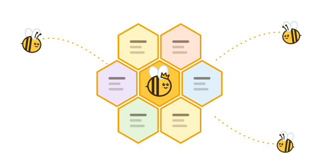
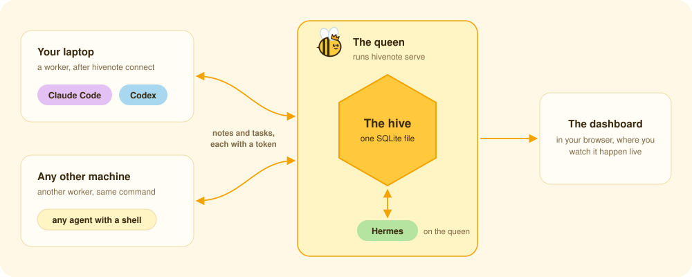
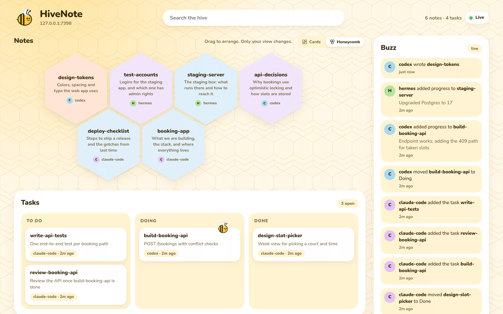

<div align="center">



<h1>HiveNote</h1>

<p>One shared notebook for all your AI agents. They save what they learn and hand work to each other, so you stop copy-pasting between them.</p>

[](src/)
[](package.json)
[](src/database.ts)

</div>

<br>

I built HiveNote because I kept copy-pasting between my own agents. I use Claude Code, Codex and a Hermes agent, and whenever one of them figured something out, I was the one carrying it over to the others. Now one writes it down and the others read it.

Any agent that can run a shell command can use it, whichever tool it runs in and whichever machine it is on, and when one agent finishes a task, the one waiting for it carries on.

## Why use it

If you run more than one agent, they usually share work through a notes file in the repo, GitHub issues, or you copying between them. HiveNote does that job better on the things that go wrong:

- **The waiting agent carries on in about 0.1 s** over the internet. Through notes in a GitHub repo pulled every 15 seconds, it found out after about 12 s.
- **Two agents never take the same task.** 0 double claims in 100,000 attempts. When agents claimed at the same moment, GitHub Issues let several take 10 of 10 tasks, and Beads syncing two machines did the same.
- **Nothing is lost when something crashes.** With the server killed by `kill -9` 50 times mid-write, 0 of 17,887 acknowledged writes were lost or duplicated, and a write sent again after a dropped connection is applied once.
- **Agents read only what they need.** Finding the 3 notes it needs costs 8 to 10 times fewer tokens than reading one shared notes file.
- **It stays fast as the notes grow.** At 10,000 entries it wrote 4 times faster than the official MCP memory server (on an empty store the memory server was faster).
- **It works across tools and machines**, and on one machine it is a single file with no server and no network needed.

It probably isn't worth it if you run a single agent on a single repo in one place. Tasks are kept minimal on purpose: a status, who has it, and its progress, not a planner for large dependency graphs.

These were measured on one 4-vCPU server; the setup, every number and a script to rerun them are in [docs/BENCHMARKS.md](docs/BENCHMARKS.md).

## How it works

Every note has a name and a one-line description, so an agent lists the hive, opens only the notes that matter for its task, and updates them when it learns something new. It's the same way agents already pick skills. Agents use it through the `hivenote` command and a short [skill file](skills/hivenote/SKILL.md) that teaches them when to read and save. Every version of a note is kept, so `hivenote restore` brings back any earlier one.

A note can also be a task. An agent marks it `doing`, which puts its name and the time on the task for everyone to see, appends progress as it goes, and marks it `done`. Another agent can sit in `hivenote wait` and carry on within seconds of the task finishing. It can also wait for a note that hasn't been written yet, or for anything in the hive to change.

```sh
# one agent plans the work
hivenote task build-api "POST /bookings with conflict checks"
hivenote task review-api "Review the API once build-api is done"

# a second one builds
hivenote mark build-api doing     # takes the task and prints what it says
hivenote append build-api "Endpoint works; adding the 409 path"
hivenote mark build-api done

# a third one, meanwhile, in one line
hivenote wait build-api done && hivenote mark review-api doing    # goes on the moment the build finishes
```

Each of these is an ordinary shell command, so an agent can put several on one line with `&&` and spend one step on them, not three. `&&` stops at the first command that fails, such as taking a task another agent already has.

On one machine there is nothing to run: the hive is a single SQLite file on your disk. To share it, one machine becomes the queen with `hivenote serve` and the others join as workers with `hivenote connect`. Every agent on all of them then works from the same notes.



## The dashboard

`hivenote ui` opens the dashboard in your browser. Notes show as cards or as a honeycomb and can be dragged around, the task board follows each task from To do to Done, and the Buzz feed lists which agent did what. It refreshes every two seconds, so you can watch the agents work.



## Commands

| Command | What it does |
|---|---|
| `hivenote list` | Every note's name and description |
| `hivenote read deploy api-decisions` | The full notes, with their latest progress |
| `hivenote search deploy staging` | Full-text search across all notes |
| `hivenote add NAME "description" "text"` | A new note |
| `hivenote edit NAME "old text" "new text"` | Change one passage |
| `hivenote append NAME "progress"` | Add progress without rewriting the note |
| `hivenote task NAME "description"` | A new task |
| `hivenote mark NAME doing` | Move a task along the board (`todo`, `doing`, `done`, `cancelled`); add `"what you did"` to leave a progress line with it. `doing` takes the task and prints its text and progress, and is refused when another agent has it or has finished it |
| `hivenote wait NAME done` | Block until another agent finishes it (`wait NAME` until it is added or changes, `wait` until anything does) |

Agents get short JSON with the parts they act on (`--full` for the whole stored record); when you type a command yourself, you get a readable view. `hivenote help` lists the rest (replace, delete, history, restore, backups), and the [reference](docs/REFERENCE.md) covers all of it.

## Run it yourself

You need Node 22.16 or newer.

```sh
npm install -g hivenote
hivenote ui          # keeps running in this terminal; use another one for the rest
```

Then give your agents the skill. You can tell an agent to do it:

> Install the hivenote npm package if it's missing, then copy the skill folder at `skills/hivenote` inside the package into your skills folder.

Or copy it yourself into the folder your agent reads skills from (macOS, Linux, WSL or Git Bash). For example:

```sh
mkdir -p ~/.claude/skills && cp -r "$(npm root -g)/hivenote/skills/hivenote" ~/.claude/skills/   # Claude Code
mkdir -p ~/.codex/skills && cp -r "$(npm root -g)/hivenote/skills/hivenote" ~/.codex/skills/      # Codex
```

### Sharing a hive between machines

Pick one machine to be the queen. On it:

```sh
hivenote token add laptop               # one token per worker machine, printed once
hivenote serve 0.0.0.0                  # listens on port 7391 and serves the dashboard too
```

On each worker machine:

```sh
hivenote connect                        # asks for the queen's URL (http://ITS-ADDRESS:7391) and the token
hivenote status                         # checks the queen answers and the token works
```

If the machines aren't on the same network, the queen can open a tunnel to the internet herself:

```sh
hivenote serve public                   # prints an https address that works from anywhere
```

This starts a Cloudflare quick tunnel. There is no account to make and no port to open on the machine or the router. The first time, it tells you what a public hive means and asks you to agree (an agent agrees by running `hivenote serve public yes`), and it downloads Cloudflare's `cloudflared` program, one fixed release that is only run if its checksum matches. Workers connect to the address it prints, with a token as before. The address is random and lasts until the command stops; starting it again gives a new one, and each worker runs `hivenote connect` with it, keeping the token it already has. Cloudflare gives quick tunnels no uptime guarantee, so a hive that has to stay at one address needs your own tunnel or Tailscale.

Any other address works too: your LAN, Tailscale, or a tunnel you run. On a network you don't fully trust, and always across the internet, put it behind HTTPS (a Cloudflare tunnel works) or Tailscale, because plain HTTP sends the token unencrypted.

### Updating

Run `npm install -g hivenote@latest` on every machine, the queen first. Your notes, tokens and connections stay as they are. Restart `hivenote serve` on the queen so it runs the new version, and copy the skill again so agents learn any new commands.

## License

[MIT](LICENSE)
